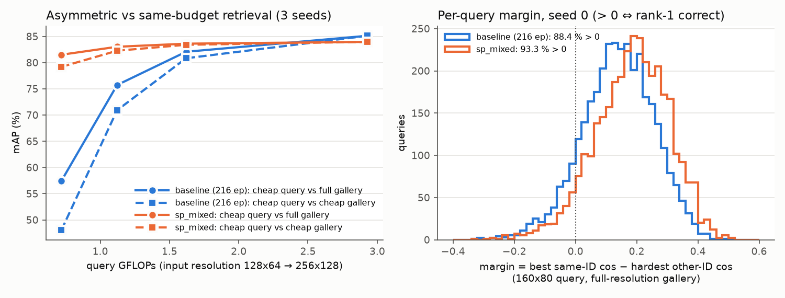

# Why does `sp_mixed` work? Mechanism analysis (evaluation only)

**2026-11-21, session 5.**
- No ViT was trained: evaluation of 18 existing checkpoints (6 models × 3 seeds).
- GPU wall-clock time used: **about 5.2 minutes** (312 s, including CPU image caching) of the 20-minute budget.
- Nothing committed. The iteration-1 report and all earlier results are unchanged.
- Data: `runs/mech_diag/` (per-seed CSV, aggregate `agg.md`, figure `mech_diag.png`, per-query arrays `*.npz`).
- Code: `mech_diag.py`, `aggregate_mech_diag.py`.

Models used (all ViT-S/16, Market-1501, 3 seeds each):

| Name | Training | Role here |
| --- | --- | --- |
| `base_e216` | Standard re-ID training, 216 epochs (equal GPU-hours) | Baseline |
| `sp_mixed` | Two passes per step; cheap pass drawn from 4 resolutions + 5 merge rates; shared classifier + cosine alignment | Our method |
| `sp_lowres` | Same, cheap pass from low resolutions only | Specialist (resolution) |
| `sp_merge_r` | Same, cheap pass from gradual merging only | Specialist (merging) |
| `tbsd` | Earlier probe: two passes, 3-stage merge, shared classifier + alignment (λ = 1) | Alignment ablation, with |
| `tbsd_nosd` | Identical to `tbsd` with the alignment term removed (λ = 0) | Alignment ablation, without |

## 1. Research questions

1. Mixed-budget training against low-resolution-only training.
2. Mixed-budget training against token-merging-only training.
3. Effect of the cosine embedding alignment.
4. Compatibility between full-resolution and low-resolution embeddings: **is the baseline's low-budget loss
   due to incompatibility (the cheap embedding lands in the wrong place relative to a full-cost gallery) or to
   lost information (the cheap embedding is itself less discriminative)?** Which of the two does `sp_mixed`
   fix?
5. Performance across query resolutions and token budgets.
6. (Added) Why `sp_mixed` is 1.16 mAP below the baseline at full cost.

## 2. Existing evidence (audit before any GPU use) and what was missing

| # | Research question | Existing evidence (before today) | Missing evidence | Cheapest way to investigate | GPU time (est.) |
| --- | --- | --- | --- | --- | --- |
| 1 | Mixed vs low-resolution-only | Report 6.4, 3 seeds: `sp_mixed` +0.5 to +0.75 mAP over `sp_lowres` at every low resolution; `sp_lowres` 79.6 under merging. Drift `q_cos` for both (`runs/sp_mechanism_agg.md`) | Whether the low-resolution gain comes from better cheap features or better alignment | Same-budget retrieval + similarity margins on existing checkpoints | about 1 min (in the diagnostic) |
| 2 | Mixed vs merging-only | Report 6.4: `sp_merge_r` best under merging (82.90 vs 82.38), 73.0 at 128x64 | Same as 1 | Same | in the diagnostic |
| 3 | Alignment term | 3-stage probe, 3 seeds: 81.99 (`tbsd`) vs 80.56 (`tbsd_nosd`) at keep 0.5; drift in `mech.csv` / `mechanism.csv` | **No `sp_mixed` without alignment** (needs training, excluded by the brief). Effect on similarity structure not measured | Diagnostic on `tbsd` vs `tbsd_nosd` (controlled pair, eval only). `sp_mixed` λ = 0 would need 3 × about 0.4 GPU-h of training: **not done** | about 1 min; training about 1.2 GPU-h (not allowed) |
| 4 | Compatibility vs information loss | `q_cos` and `offset_frac` for every model and budget; mean, affine and ridge corrections help the baseline only partly (Report 6.4, `NONLINEAR_MAPPING_BASELINE.md`) | **Never measured:** retrieval with query *and* gallery at the cheap budget. Without it, drift cannot be separated from loss of discriminative information | **Chosen diagnostic:** symmetric cheap-vs-cheap retrieval next to asymmetric | about 1 min per 3 checkpoints |
| 5 | Performance across budgets | Complete: Report 6.4 (4 resolutions, 2 merge rates, 7 models), 6.6 (latency), sweeps | Nothing essential | — | 0 |
| 6 | Full-cost deficit | Per-budget BatchNorm ruled out (Report 6.5) | Which part of the similarity structure changes | Margin statistics at full budget (same pass) | in the diagnostic |

**Decision.** Question 4 is the one important question that existing data cannot answer, and it is the one that
explains the main result. A single evaluation pass over existing checkpoints answers 4 and adds evidence for 1,
2, 3 and 6, well within the budget. Question 5 was already answered and was not repeated: its asymmetric numbers
are recomputed here only as a by-product, and they match.

## 3. Diagnostic methodology

For each checkpoint and query budget b ∈ {full 256x128, 192x96, 160x80, 128x64, gradual merge r = 11}:

1. Embed all 3,368 queries and all 15,913 evaluated gallery images (junk removed, distractors kept) at **both**
   the full budget and budget b. The low-resolution forward and merging are exactly as in the report
   (`mechanism.forward_res`, `model.tome_r`).
2. Compute retrieval metrics, the similarity structure and the drift (Section 4).
3. Save the per-query arrays at 160x80 for the histogram.

**Sanity checks.**
- All asymmetric mAP values reproduce the stored results: e.g. base 75.72 / `sp_mixed` 83.01 at 160x80,
  `sp_mixed` 82.37 at r = 11 (stored 82.38; rounding in averaging).
- Rank-1 equals the fraction of queries with margin > 0 (e.g. 88.36 = 0.8836), which checks the margin code.

Command:

```
.venv/Scripts/python.exe mech_diag.py --data C:/Users/user/data/Market-1501-v15.09.15 \
    --ckpts runs/{base_e216,sp_mixed,sp_lowres,sp_merge_r,tbsd,tbsd_nosd}_s{0,1,2}/last.pth \
    --out runs/mech_diag/mech_diag.csv
```

Aggregate: `PYTHONIOENCODING=utf-8 .venv/Scripts/python.exe aggregate_mech_diag.py`.

## 4. Mathematical definitions

**Notation.** f_b(x) is the L2-normalised BNNeck embedding of image x at budget b; F = full budget. Let q be a
query, P(q) its valid positives (same identity, different camera) and N(q) its negatives (different identity,
distractors included).

| Quantity | Definition | Meaning |
| --- | --- | --- |
| asym mAP / R1 | rank the gallery by cos(f_b(q), f_F(g)) | The deployment setting: cheap query, full-cost gallery |
| sym mAP / R1 | rank the gallery by cos(f_b(q), f_b(g)) | What the cheap embedding knows on its own, with no compatibility requirement |
| sym − asym | difference of the two mAPs | > 0: the cheap space is fine but misplaced (incompatibility). < 0: the full gallery is a *better* reference than a cheap one, i.e. the cheap embeddings mainly lost information |
| q_cos (g_cos) | mean over queries (gallery) of cos(f_b(x), f_F(x)) | Drift of the same image across budgets |
| pos / neg sim | mean and std of cos(f_b(q), f_F(g)) over all positive / negative pairs | Pair-level similarity structure |
| d′ | (μ₊ − μ₋) / √((σ₊² + σ₋²)/2) | Global separability of positives and negatives |
| best-pos, hardest-neg | s₊(q) = max over P(q), s₋(q) = max over N(q) | The two numbers that decide rank 1 |
| margin | m(q) = s₊(q) − s₋(q); R1 = fraction with m > 0 | Per-query safety margin |
| top-1 broken / fixed | queries correct with the full query but wrong with the budget-b query, and the reverse | Errors caused by the budget |

## 5. Results and interpretation

All values are mean ± std over 3 seeds, with mAP in %. Full tables: `runs/mech_diag/agg.md`.



### 5.1 The baseline loses information, not mainly compatibility (question 4)

| 160x80 query (1.12 GFLOPs) | asym mAP | sym mAP | sym − asym | q_cos | best-pos | hardest-neg | margin | top-1 broken / fixed |
| --- | --- | --- | --- | --- | --- | --- | --- | --- |
| `base_e216` | 75.72 ± 0.51 | 70.92 ± 2.20 | −4.80 | 0.770 | 0.587 | 0.445 | 0.142 | 238 / 40 |
| `sp_mixed` | 83.01 ± 0.15 | 82.26 ± 0.18 | −0.75 | 0.953 | 0.718 | 0.534 | 0.184 | 59 / 32 |
| `sp_lowres` | 82.36 ± 0.19 | 81.79 ± 0.14 | −0.57 | 0.962 | 0.731 | 0.547 | 0.184 | 42 / 31 |

- **Symmetric is below asymmetric for every model at every reduced budget** (Table A of `agg.md`). For the
  baseline the gap grows from −1.2 (192x96) to −4.8 (160x80) and −9.4 (128x64).
  - If the baseline's cheap embeddings were good but merely displaced, cheap-vs-cheap retrieval would be
    *better* than cheap-vs-full. It is worse.
  - So the dominant failure is that low-resolution embeddings of the baseline carry less identity information.
    Putting cheap embeddings on *both* sides compounds it.
  - This agrees with the existing results: the offset is mostly per-image (`offset_frac` 0.15-0.20), and mean,
    affine, ridge and VPFA-style MLP corrections recover only 3-4 of the 9.4 mAP lost at 160x80. A map cannot
    restore information that is not there.
- **`sp_mixed` mainly fixes the information loss.** At 160x80 its same-budget mAP rises by **+11.3** (70.9 →
  82.3), more than its asymmetric gain (+7.3).
  - Its cheap embeddings are nearly as discriminative as its full ones: sym 82.26 vs full 83.95.
  - They are also close to them: q_cos 0.95 vs 0.77.
  - In other words, the network has become largely **resolution-invariant**, rather than learning a separate
    cheap space that is mapped onto the full one.
- **Similarity structure (right panel of the figure).** The baseline's positive similarities fall with budget
  (best-pos 0.714 → 0.587 from full to 160x80), while the hardest negatives fall less (0.500 → 0.445). The
  margin shrinks from 0.214 to 0.142, and 238 ± 3 queries that are correct at full cost become wrong at 160x80.
  - `sp_mixed`'s margin barely moves (0.192 → 0.184), and only 59 ± 10 queries break.
  - "Fixed" counts are similar for both (30-40). The budget mostly *removes* correct matches; it rarely
    creates them.

### 5.2 Mixed versus specialists (questions 1 and 2): invariance is learned per knob

| q_cos (asym mAP) | 192x96 | 160x80 | 128x64 | merge r = 11 |
| --- | --- | --- | --- | --- |
| `base_e216` | 0.890 (82.06) | 0.770 (75.72) | 0.565 (57.45) | 0.849 (78.97) |
| `sp_lowres` | 0.976 (82.85) | 0.962 (82.36) | 0.931 (80.96) | 0.920 (79.58) |
| `sp_merge_r` | 0.929 (82.68) | 0.865 (79.89) | 0.751 (73.04) | 0.952 (82.89) |
| `sp_mixed` | 0.971 (83.60) | 0.953 (83.01) | 0.916 (81.50) | 0.953 (82.37) |

- **Specialists.** Each specialist is near-invariant on its own knob and much less so on the other. The
  resolution specialist reaches 0.92 under merging, against 0.95 for the models that saw merging. The merging
  specialist reaches 0.75-0.87 at low resolution.
- **`sp_mixed`** reaches the invariance of each specialist on that specialist's knob (within 0.01-0.015 q_cos).
  This is the mechanism-level counterpart of the report's finding that compatibility is learned per knob.
- **The puzzle.** At low resolution `sp_mixed` has *slightly lower* q_cos than `sp_lowres` (0.953 vs 0.962 at
  160x80) but *higher* mAP (83.01 vs 82.36). Why?
  - The difference is not in drift. It is at the top of the ranking: `sp_mixed` has a lower hardest-negative
    similarity (0.534 vs 0.547) at a similar margin.
  - Its full-budget embedding is also better: 83.95 vs 83.09 full mAP; d′ 4.70 vs 4.65.
  - So at low resolution, part of `sp_mixed`'s advantage over `sp_lowres` is a better full-cost gallery and
    full-cost embedding, not a better cheap query. This is correlational; the two models differ only in the
    budget distribution of the cheap pass.

### 5.3 The alignment term (question 3): controlled ablation, 3 seeds, older 3-stage schedule

`tbsd` and `tbsd_nosd` are identical except for the alignment weight (λ = 1 vs 0). Both were trained with
3-stage merging, so merge r = 11 is their closest test budget.

| | asym mAP r = 11 | sym mAP r = 11 | q_cos r = 11 | full mAP | full d′ | full best-pos / hardest-neg |
| --- | --- | --- | --- | --- | --- | --- |
| `tbsd_nosd` (shared classifier only) | 80.84 ± 0.27 | 78.84 ± 0.26 | 0.916 | 83.71 | 4.25 | 0.691 / 0.484 |
| `tbsd` (+ cosine alignment) | 81.78 ± 0.18 | 80.19 ± 0.15 | 0.942 | 83.95 | 4.63 | 0.720 / 0.527 |
| `base_e216` (reference) | 78.97 ± 0.10 | 74.04 ± 0.37 | 0.849 | 85.11 | 4.40 | 0.714 / 0.500 |

- **Effect of the alignment term** (an intervention, so causal for *this* training schedule):
  - drift at r = 11 falls (q_cos +0.026);
  - asymmetric mAP rises by about +0.9;
  - same-budget mAP rises by about +1.4.
  - It also raises full-cost d′ (4.25 → 4.63) and both best-pos and hardest-neg similarities.
- **Shared classifier and cheap pass alone.** Without the alignment term, two-pass training already moves q_cos
  from 0.849 (baseline) to 0.916 at r = 11. That is about 70 % of the way to `tbsd`'s 0.942, so most of the
  invariance comes from the two-pass training with a shared classifier, with alignment on top. This matches the
  earlier ablation (+1.4 mAP from alignment at keep 0.5).
- **Neither 3-stage model transfers to low resolution** (q_cos 0.68-0.71 at 128x64). This confirms again that
  invariance is learned only for the budgets seen in training.
- **Not shown:** whether `sp_mixed` needs the alignment term. No `sp_mixed` with λ = 0 exists.

### 5.4 The full-cost deficit (question 6)

At full budget, every two-pass model trained *with* the alignment term has **higher hardest-negative
similarity** than the baseline: 0.523-0.553 against 0.500 (`sp_mixed` 0.543, `sp_lowres` 0.553, `sp_merge_r`
0.523, `tbsd` 0.527). `tbsd_nosd`, without alignment, is the exception at 0.484. These four models also have a
smaller mean margin: 0.190-0.196 against 0.214.

Their global separability d′ is *higher* (4.62-4.70 against 4.40). So these models are better separated on
average but have harder top negatives, and mAP and Rank-1 depend on the top of the ranking.

**Hypothesis, not tested:** training the same weights to work at low resolution favours coarse, resolution-stable
cues (colour, layout). These separate most identities well but make look-alike identities more similar. That
would cost a little at full resolution, where fine detail would otherwise separate them.

### 5.5 Correlations across all settings (descriptive only)

Over the 72 reduced-budget settings (6 models × 4 budgets × 3 seeds), asymmetric mAP is rank-correlated with:

| Predictor | Spearman ρ |
| --- | --- |
| Same-budget (sym) mAP | 0.99 |
| q_cos | 0.92 |
| d′ | 0.91 |
| Mean margin | 0.90 |

Model and budget vary together here, so these are associations, not effects. In particular they do not show
that reducing drift *causes* higher mAP. Discriminative information and drift move together, and Section 5.1
indicates information is the larger factor.

## 6. Limitations

1. **Only one controlled intervention.** The alignment ablation (`tbsd` vs `tbsd_nosd`) is the only pair that
   differs in a single component. It uses the older 3-stage schedule, not `sp_mixed`'s budget distribution.
   Everything else compares models that differ in several ways (budget distribution, and hence what the full
   embedding learns).
2. **No `sp_mixed` ablations.** No λ = 0 run and no separate-classifier run. Testing these needs training,
   which was excluded.
3. **"Information" is operational.** It means same-budget retrieval quality, not an information-theoretic
   quantity. The symmetric score also degrades the gallery, so "sym − asym" is a contrast, not an additive
   decomposition.
4. **One dataset with native 128x64 crops.** Low-resolution "information loss" may look different on
   native-resolution data, where downsampling removes real detail.
5. **Seeds and pairing.** 3 seeds; differences of about 0.1 in q_cos or about 0.5 mAP between `sp_mixed` and
   the specialists are small relative to their spread in some cells.
6. **Fixed threshold choices.** The histogram uses seed 0 and 160x80 only. Per-query arrays for the other
   seeds are saved for checking.

## 7. What we can and cannot conclude

**Supported by this diagnostic and existing results:**
- The baseline's low-budget failure is mainly that its cheap embeddings lose identity-discriminative
  information. A pure misplacement that a map could undo is the smaller part. This explains why post-hoc maps,
  linear or non-linear, recover only part of the loss.
- `sp_mixed` makes the cheap-input embedding itself discriminative and close to the full embedding
  (q_cos ≥ 0.95 at 160x80). The ranking margin stays nearly constant across budgets, and 4× fewer correct
  matches are broken at 160x80.
- That invariance is specific to the knobs seen in training. `sp_mixed` covers both knobs at about the level of
  each specialist.
- In a controlled ablation on the older schedule, the cosine alignment term reduces drift and improves both
  cheap and full retrieval. Most of the invariance already comes from two-pass training with the shared
  classifier.

**Hypotheses (correlational or untested):**
- `sp_mixed`'s small lead over `sp_lowres` at low resolution comes from its better full-cost embedding and
  harder-to-confuse top negatives, not from lower drift.
- The full-cost deficit comes from raised hardest-negative similarity, a by-product of learning
  resolution-stable features.

**Cannot be concluded:**
- That the alignment term matters for `sp_mixed` specifically.
- That lower drift causes higher mAP.
- That the same mechanism holds on native-resolution data.
- Anything about other backbones.

**Cheapest next tests** (training, so not done here):
- `sp_mixed` with λ = 0, 3 seeds, about 1.2 GPU-h: is alignment needed?
- A run with separate classifiers per pass: does the shared classifier drive the invariance?
