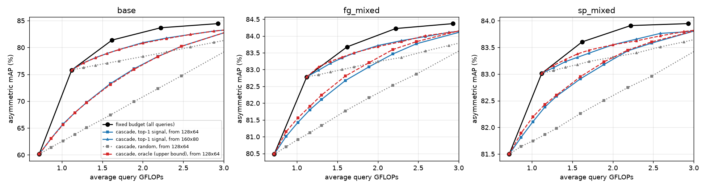

# First research iteration: budget-compatible queries for ViT person re-identification

**Iteration-1 report, final version of 2026-11-17.** Market-1501, ViT-S/16, 3 seeds per configuration unless
stated; latency measured on an RTX 5080 / Ryzen 7 7800X3D. All numbers come from our own runs (`runs/`,
aggregated in `runs/*_agg.md`, `PROGRESS_LOG.md`). Companion documents: `STUDY_GUIDE.md` (beginner-level
explanation of everything below), `SUPERVISOR_QA.md` (likely questions and answers), `LITERATURE_MATRIX.md`
(reading depth and details of every paper).

## Summary

**Problem.** In person re-identification (re-ID) a gallery is embedded once at full cost, while queries
arrive continuously, possibly on weak devices. We want cheaper queries whose embeddings stay *compatible* with
the full-cost gallery, using the two input-side knobs of a vision transformer: a smaller input image and fewer
tokens (token merging).

**Method.** One ViT trained with two passes per step through shared weights: a full pass and a cheap pass whose
budget is drawn at random from both knobs (four input resolutions, five merge rates). Both passes use the
standard re-ID losses through a shared classifier, and the cheap embedding is pulled onto the detached
full-cost embedding. This is a credited combination of existing techniques (BCT/SFSC-style shared classifier,
D3still / Suma-Tolias alignment loss, ResFormer-style multi-resolution training, ToMe merging), applied to
input-side compute knobs for compatible retrieval.

**Results (3 seeds).**
- Asymmetric mAP of our method: 83.60 at 1.62 GFLOPs (55 % of full cost), 83.01 at 1.12 GFLOPs (38 %) and
  81.50 at 0.72 GFLOPs (25 %).
- The equal-GPU-hour baseline with a linear correction map reaches 82.80 at 1.62 and 78.96 at 1.12 GFLOPs. Our
  method is +0.8 to +4.1 mAP better below about 1.7 GFLOPs, and 1.16 worse at full cost (83.95 vs 85.11).
- A model trained on only one knob is not compatible on the other.
- Measured latency: lower resolution gives 1.7-3.9x speed-ups on CPU and at large GPU batch. Token merging is
  slower and less accurate than resolution on this dataset, and nothing reduces single-image GPU latency.
- A prior-work-style frozen-gallery student ties our method on low resolution without the full-cost loss.
- A preliminary per-query cascade selects the right queries to escalate (oracle-level signal) but is dominated
  by fixed budgets at equal cost.

**Status.** A defensible empirical first iteration with honest negative results. Main limitation: one dataset
whose crops are natively 128x64.

---

## 1. Problem and thesis

The project thesis is accuracy per unit of resource: compute, labels and training time. Re-ID compares a query
image of a person with a gallery of images from other cameras by the cosine similarity of their embeddings.

**Asymmetric retrieval.** The gallery is embedded offline at full cost and stored. The query is embedded at
request time and should be cheap. This works only if the cheap query embedding is **compatible** with the
full-cost gallery embedding, i.e. directly comparable without re-indexing the gallery.

**Input-side knobs of a ViT.** A ViT's cost scales with its number of tokens. It can be reduced without changing
the weights in two ways: a smaller input image (fewer patches) or merging tokens inside the network. Both can
be chosen per query at run time.

**Research questions.**
1. How much accuracy does a ViT re-ID model lose when only the query is made cheap, and why?
2. What is the least expensive way to train one model that stays compatible with its own full-cost gallery
   under these knobs?
3. Do GFLOPs savings become real speed-ups?
4. Can compute be spent per query, only where it is needed?

## 2. Related work and comparison

Reading-depth codes: `FULL` = whole text read; `FULL-S` = whole text read through a summarising tool
(equations as reported by the tool); `ABS` = abstract or search result only. "Not found" means not found in
what was read, never "the paper lacks it". Abstract-level entries are not used for any claim of absence.

### 2.1 Comparison table (six closest papers)

| | SFSC | D3still | Suma and Tolias | ResFormer | PrunNet | DVT | **This work** |
| --- | --- | --- | --- | --- | --- | --- | --- |
| Reference | Wu et al., CVPR 2023 | Xie et al., CVPR 2024 | Suma, Tolias, WACV 2023 | Tian et al., CVPR 2023 | Sun et al., arXiv 2504.11879, 2025 | Wang et al., NeurIPS 2021 | — |
| Depth read | `FULL-S` | `FULL` | `FULL-S` | `FULL-S` | `FULL-S` | `ABS` | — |
| Goal | Several compatible sub-models from one training run | Small query network ranks like a large gallery network | Small-resolution queries vs large-resolution database | One ViT that works at many resolutions | Several compatible sub-networks of one network | Fewer tokens for easy images | One ViT whose cheap queries match its full-cost gallery |
| What is made cheap | CNN channel width | A separate small network (+ resolution) | Input resolution | Input resolution | Weights (unstructured pruning) | Token count, per image | Input resolution and token count |
| One set of weights for several budgets | Yes (separate BN per width) | No | No (one student per resolution) | Yes | Yes | Yes (cascade of models with feature reuse) | Yes |
| Cheap query vs full-cost gallery evaluated | Yes | Yes | Yes | No (classification) | Yes | No (classification) | Yes |
| Compatibility / training signal | Shared classifier, evidential loss, gradient projection | Frozen teacher; feature + ranking-difference losses | Frozen teacher; same-architecture student, label-free | Detached high-resolution class token teaches low resolution | Shared classifier (BCT-style), gradient-conflict projection | Confidence-based early exit | Shared classifier + cosine alignment to detached full pass |
| Backbone | ResNet, MobileNet, ShuffleNet | ResNet, SwinV2 / ResNet-18, MobileNetV2 | ResNet-50/18 | ViT (DeiT) | ResNet, MobileNet, ViT-S | ViT, DeiT, T2T-ViT | ViT-S/16 (ViT-B/16 one seed) |
| Person re-ID data | Market-1501, MSMT17 | MSMT17 | None (CUB, Cars, SOP) | None | Market-1501, MSMT17 (appendix) | None | Market-1501 |
| Costs reported | Parameter ratios | Inference FLOPs | Query GFLOPs (figures) | Training time | FLOPs in a figure; no latency | FLOPs, speed | GFLOPs, measured latency (4 regimes), training GPU-hours, equal-budget baseline |

Other work used (details in `LITERATURE_MATRIX.md`):
- **Token reduction:** ToMe (ICLR 2023, our merging tool, verified against its official code) and EViT
  (ICLR 2022, class-attention top-k).
- **Distillation with token pruning for re-ID, one budget per model:** SUReID (arXiv 2024, `FULL`), which
  reports 87.2 mAP on Market-1501 with a DeiT-S student and a separate teacher.
- **Cross-resolution re-ID** (RFD, arXiv 2021, `FULL-S`): low resolution is a degradation and the query is
  upsampled to full network input, so no compute is saved.
- **Cascades for classification:** RANet (CVPR 2020, resolution, `ABS`).
- **Query performance prediction for image retrieval:** iQPP (2023, `ABS`).
- **Recent work at abstract level only:** QuARI (NeurIPS 2025, query-adaptive embedding transform), ACD (CVPR
  2026 Findings, asymmetric distillation) and ThinkingViT (CVPR 2026, nested elastic ViT).

### 2.2 What prior work already establishes
1. One training run giving several mutually compatible re-ID models (SFSC; PrunNet, including a ViT-S).
2. Asymmetric re-ID with a cheap query encoder (SFSC, D3still).
3. The alignment loss `1 - cos(cheap, sg(full))` is the standard feature term of asymmetric retrieval
   (D3still's `L_f`, Suma and Tolias's `l_abs`).
4. A frozen gallery model with a same-architecture student for cheaper queries (Suma and Tolias).
5. Multi-resolution ViT training with a detached higher-resolution teacher (ResFormer).
6. Per-sample compute selection by confidence (RANet, DVT), for classification.

## 3. Research gap (preliminary)

Not found in the papers read and about 40 searches (absence of evidence, not proof of absence):
- **input-side** query budgets of one ViT re-ID model (input resolution, token count) used as a **compute**
  knob, with the cheap query compatible with the same model's full-cost gallery. Cross-resolution re-ID
  upsamples the query; SFSC and PrunNet shrink the weights; ResFormer has no retrieval;
- one set of weights compatible under **two input-side knobs at once**;
- a **cost account** of compatibility: training GPU-hours against an equal-GPU-hour baseline, accuracy lost at
  full cost, and measured latency per regime instead of FLOPs only;
- a **retrieval-side confidence** to choose the query budget per query (cascades in RANet/DVT use softmax
  confidence for classification).

**Position.** The contribution of iteration 1 is an adaptation and combination of existing techniques for
this setting, plus a careful, cost-accounted evaluation with negative results. It is not a new learning
principle. This is acceptable for iteration 1 (revised project rule, 2026-11-17); every component is credited.

## 4. Methodology

### 4.1 Architecture
```
                             shared weights θ (ViT-S/16), shared BNNeck, shared classifier W
                    ┌──────────────────────────────────────────────────────────────────────────────┐
 full pass   x ───► │ resize 256x128 → 128 patches + [CLS] → 12 blocks → [CLS] → BNNeck → e_full  │──► W ─► CE, Tri
                    │                                                                              │
 cheap pass  x ───► │ budget b ~ U{ lowres 224x112 | 192x96 | 160x80 | 128x64   (prob. 1/2)        │──► W ─► CE, Tri
                    │              merge r ∈ {3,5,7,9,11} tokens per block       (prob. 1/2) } → e_b│
                    └──────────────────────────────────────────────────────────────────────────────┘
                                         alignment: 1 − cos(e_b, stopgrad(e_full))
 Test time:  gallery ← e_full (once, offline);   query ← e_b for any budget the device affords
             (optional, Section 6.9: cheap query first, escalate low-confidence queries to full cost)
```
ViT-S/16: width d = 384, 12 blocks, 6 heads, MLP width 1536, 22 M parameters, ImageNet-21k→1k pretrained
(timm augreg). Input 256x128 → 16x8 = 128 patch tokens + 1 class token. Retrieval embedding: BNNeck output of
the class token, L2-normalised.

### 4.2 Notation
`x` image, `y` identity label (751 training identities). `f(x; b)` = L2-normalised BNNeck embedding at budget
`b`, `h(x; b)` = pre-BNNeck feature. Budgets: `full`; `lowres(H, W)`; `merge(r)`. Gallery always `f(x; full)`.
`sg` = stop-gradient.

### 4.3 The two cheap-query knobs
**Lower resolution.** The image is resized (bicubic, anti-aliased) to H x W, giving `n = (H/16)(W/16)` patch
tokens (72, 50 or 32 for 192x96, 160x80, 128x64). The learned 16x8 position embedding is resampled bicubically
to the new grid. All 12 blocks then run on n + 1 tokens.

**Gradual token merging (ToMe).** After the attention of every block, the patch tokens are split alternately
into sets A and B; each token of A is matched to its most similar token of B by the cosine of the attention
keys (averaged over heads); the `r` best-matching pairs are merged by a size-weighted average,
`t_new = (s_a t_a + s_b t_b) / (s_a + s_b)`, `s_new = s_a + s_b` (s = number of original patches represented),
and attention uses proportional attention (log-size bias). Each block removes `min(r, n/2)` of its n patch tokens,
so with r = 11 the patch tokens shrink block by block as 128 → 117 → 106 → 95 → 84 → 73 → 62 → 51 → 40 → 29 →
18 → 9 → 5 (plus the class token), and the analytic cost, summed over the actual per-block counts, is 1.41 GFLOPs.

### 4.4 Training objective (`sp_mixed`)
For a batch of P x K = 16 x 4 images, with one budget b drawn per step:

`L = L_id(full) + L_tri(full) + L_id(b) + L_tri(b) + λ · L_align(b)`, λ = 1, where

- `L_id(b) = (1/N) Σ_i CE_ε(W f̃(x_i; b), y_i)`: cross-entropy with label smoothing ε = 0.1 on the classifier
  logits (`f̃` = un-normalised BNNeck output). **W is shared by both passes**, so both embeddings must fall on
  the same side of the same class boundaries (the BCT mechanism).
- `L_tri(b) = (1/N) Σ_i max(0, max_{p: y_p = y_i} ‖h_i − h_p‖ − min_{n: y_n ≠ y_i} ‖h_i − h_n‖ + m)`: batch-hard
  triplet loss on the pre-BNNeck feature, margin m = 0.3.
- `L_align(b) = (1/N) Σ_i [1 − cos(f(x_i; b), sg f(x_i; full))]`: pulls the cheap embedding onto the full one;
  stop-gradient keeps the full embedding (the gallery side) from being pulled towards the cheap one.

Variants for the ablation: `sp_lowres` (b always a resolution), `sp_merge_r` (b always a merge rate).

### 4.5 Per-query budget selection (preliminary, evaluation only)
For a query q: compute `f(q; c)` at a cheap budget c (128x64 or 160x80) and its similarities to the gallery.
Confidence `s(q) = max_g cos(f(q; c), f(g; full))` (top-1 similarity). Escalate the fraction p of queries with the
lowest `s(q)` to `f(q; full)`. Average query cost `G(p) = G_c + p · G_full`. Compared at equal `G(p)` with the
fixed-budget curve (all queries at one resolution), with random escalation (does `s` carry information?) and an
oracle escalating the largest `1 − cos(f(q; c), f(q; full))` (needs the full pass; upper bound). Whole curve over
p reported, no threshold tuned. Adaptation of RANet/DVT cascades to retrieval with a query-performance-prediction
style confidence.

### 4.6 Cost model
Analytic GFLOPs (multiply-accumulates) per block with n tokens: `4nd² + 2n²d + 2ndh` (d = 384, h = 1536), plus
the patch embedding `n_patches · 768 · d`. Full cost: 12 x 0.241 G + 0.038 G = **2.93 GFLOPs**. Merging uses the
actual token count of every block. Latency is measured separately (Section 6.6), because GFLOPs do not predict it.

## 5. Experimental protocol

- **Data:** Market-1501. Train: 12,936 images of 751 identities. Test: 3,368 queries; gallery 19,732 files,
  of which the 3,819 junk images (label −1) are removed as in standard toolkits, leaving 15,913 (including
  2,798 distractors, label 0000; counts verified on the files). Standard protocol: same-identity same-camera gallery images are ignored per query.
- **Metrics:** mAP (main) and Rank-1. **Asymmetric** = cheap queries against the full-cost gallery.
  `q_cos` = mean cosine between an image's cheap and full embeddings (drift).
- **Training recipe (all runs):** batch 64 (16 identities x 4 images), 120 epochs x 202 iterations, SGD
  (momentum 0.9, weight decay 1e-4), lr 0.008, 5 warm-up epochs, cosine decay, mixed precision, RTX 5080.
  Peak VRAM 4.9 GB (two-pass), 1.8 GB (frozen-gallery student). No hyperparameter was tuned for the method.
- **Seeds:** 3 per configuration; mean ± sample std. A difference under about 2 std is not called a result.
- **Baselines (same recipe):**
  1. ordinary model, 120 epochs, with cheap queries and no retraining;
  2. **equal-GPU-hour baseline**: ordinary model, 216 epochs (0.36-0.38 GPU-h vs our 0.35-0.44), with and
     without a closed-form ridge map from cheap to full embeddings fitted on training images;
  3. multi-budget training without the alignment term;
  4. our earlier 3-stage TBSD probe;
  5. **frozen-gallery student** in the style of Suma and Tolias (frozen baseline as gallery and teacher;
     label-free student, 96 epochs).
- **Code check:** merging and top-k selection equal a transcription of the official ToMe / EViT functions
  (`check_reduction.py`, difference 0; official code read, not executed).
- **Total compute of the project:** 13.4 GPU-hours of training over 57 runs (sum of `train_hours`).

## 6. Results

### 6.1 The problem: an ordinary model degrades under cheap queries
Ordinary 120-epoch model, asymmetric mAP: full 84.45 ± 0.49; low resolution 224x112 83.67, 192x96 81.38 ± 0.36,
160x80 75.81 ± 0.43, 128x64 60.13 ± 2.68; gradual merging r = 11 77.45 ± 1.39; 3-stage merging (half the tokens at
blocks 4, 7, 10) 68.56 ± 1.14. Drift is large (`q_cos` 0.61 at 128x64).

### 6.2 How the query is made cheap matters more than how much
At about 1.4-1.5 GFLOPs the ordinary model scores 68.6 (3-stage merge), 77.5 (gradual merge) or about 79.6 (low
resolution, interpolated). Halving the tokens at a single block costs 3.8 mAP at block 4, 1.2 at block 7 and
0.2 at block 10: early reduction is the costly part. Drift is per-image (a shared offset explains 3-16 % of it;
mean or affine corrections give +0.1 to +1.5 mAP); a linear map recovers +1 to +4.

### 6.3 Negative result: our first method (3-stage TBSD probe)

| Query | GFLOPs | 216-ep baseline raw | 216-ep baseline + map | TBSD probe raw (map) |
| --- | --- | --- | --- | --- |
| full | 2.93 | 85.11 | — | 83.95 ± 0.13 |
| 192x96 | 1.62 | 82.06 ± 0.19 | 82.80 ± 0.23 | 81.91 (82.34) |
| 160x80 | 1.12 | 75.72 ± 0.51 | 78.96 ± 0.18 | 78.26 (79.90) |

Its apparent +13.4 mAP at half the tokens came from comparing against the weak 3-stage schedule. Against the
equal-GPU-hour baseline with a linear map it is not better, and it is 1.16 worse at full cost. This motivated
the second-pass variants.

### 6.4 Main result: which cheap pass to train with (3 seeds each)
Asymmetric mAP, full-cost gallery; brackets = with the ridge map.

| Query | GFLOPs | Baseline 120 ep | Baseline 216 ep | TBSD probe | `sp_lowres` | `sp_merge_r` | **`sp_mixed`** |
| --- | --- | --- | --- | --- | --- | --- | --- |
| full | 2.93 | 84.45 ± 0.49 | 85.11 | 83.95 ± 0.13 | 83.09 ± 0.25 | 84.27 ± 0.07 | 83.95 ± 0.15 |
| 224x112 | 2.22 | 83.67 ± 0.49 | — | — | 83.07 ± 0.27 | 83.92 ± 0.08 | 83.91 ± 0.17 |
| merge r = 7 | 1.94 | — | 83.80 ± 0.04 | — | 82.18 ± 0.25 | 84.07 ± 0.06 | 83.70 ± 0.14 |
| 192x96 | 1.62 | 81.38 ± 0.36 | 82.06 (82.80) | 81.91 ± 0.32 | 82.85 ± 0.17 | 82.68 ± 0.10 | **83.60 ± 0.14** |
| merge r = 11 | 1.41 | 77.45 ± 1.39 | 78.97 (79.70) | 81.77 ± 0.18 | 79.59 ± 0.37 | **82.90 ± 0.13** | 82.38 ± 0.27 |
| 160x80 | 1.12 | 75.81 ± 0.43 | 75.72 (78.96) | 78.26 ± 0.38 | 82.36 ± 0.19 | 79.89 ± 0.18 | **83.01 ± 0.15** |
| 128x64 | 0.72 | 60.13 ± 2.68 | — | 69.26 ± 0.90 | 80.96 ± 0.20 | 73.04 ± 0.37 | **81.50 ± 0.22** |

Training time (GPU-h, three seeds): `sp_lowres` 0.36/0.31/0.37, `sp_merge_r` 0.44/0.40/0.46, `sp_mixed`
0.35/0.41/0.44 (seed 1 resumed and briefly shared the GPU: unreliable), 216-epoch baseline 0.36-0.38.

Findings:
1. **Compatibility is learned per knob.** Specialists do not transfer: the merge-trained model gives 73.0 at
   128x64; the resolution-trained model gives 79.6 under merging (equal to the baseline with a map, 79.7).
2. **`sp_mixed` is compatible under both knobs.** It is the best on every low-resolution setting (+0.5 to +0.75
   over the resolution specialist, about 3 std). Under merging it is 0.5 below the merge specialist (about 2 std,
   not clearly separated).
3. **Against the equal-GPU-hour baseline with the map:** +4.1 at 1.12 GFLOPs, +2.7 at 1.41, +0.8 at 1.62.
4. **Price at full cost:** −1.16 vs the 216-epoch baseline, −0.5 vs the 120-epoch baseline.
5. 81.5 mAP at a quarter of the full cost (0.72 GFLOPs). Not to be generalised: Market-1501 crops are natively
   128x64 (Section 8).

### 6.5 Ablations (completed)
- **Alignment term:** without it, multi-budget training reaches 80.56 ± 0.07 (3-stage, keep 0.5) vs 81.99 with
  it. The shared classifier does most of the work; the alignment term adds about 1.4 mAP.
- **Per-budget BatchNorm statistics** as the cause of the full-cost deficit: rejected (83.83 vs 83.95).
- **Fixed-budget specialist** (trained only at keep 0.5): loses to multi-budget training.
- **Low-data regularisation (H3):** not supported. With 10/25/50 % of the identities two-pass training is
  2.2/0.9/0.9 mAP below the baseline at full cost.
- **Token selection rule:** class-attention top-k (exact EViT fusion) is worse than random selection for
  cross-budget matching (72.93 ± 3.28 vs 78.06 ± 0.63 at keep 0.7 on the baseline; same ordering in every trained
  variant). Unexplained.

### 6.6 Measured efficiency
Forward pass, random input, idle machine, median after warm-up (`runs/latency_extra.csv`). GPU: RTX 5080,
mixed precision. CPU: 8 threads, fp32. Low-resolution rows include the resize and position-embedding resampling.

| Query | GFLOPs | GPU b1 (ms) | GPU b256 (ms/img) | CPU b1 (ms) | CPU b8 (ms/img) | mAP `sp_mixed` |
| --- | --- | --- | --- | --- | --- | --- |
| full | 2.93 | 6.04 | 0.112 | 17.9 | 12.9 | 83.95 |
| 3-stage merge 0.5 | 1.46 | 8.70 | 0.067 | 13.4 | 7.28 | 79.34 |
| merge r = 7 | 1.94 | 13.6 | 0.095 | 18.1 | 9.77 | 83.70 |
| merge r = 11 | 1.41 | 13.9 | 0.073 | 15.6 | 7.52 | 82.38 |
| 224x112 | 2.22 | 6.13 | 0.080 | 15.1 | 10.1 | 83.91 |
| 192x96 | 1.62 | 6.16 | 0.058 | 13.0 | 7.56 | 83.60 |
| 160x80 | 1.12 | 6.16 | 0.042 | 10.6 | 5.49 | 83.01 |
| 128x64 | 0.72 | 6.16 | 0.029 | 8.87 | 3.78 | 81.50 |

1. **GFLOPs do not predict latency.** A single image on the GPU costs about 6 ms at any token count (overhead
   bound). Savings appear where arithmetic dominates: 160x80 is 2.67x faster at GPU batch 256, 1.69x at CPU
   batch 1, 2.35x at CPU batch 8; 128x64 3.9x, 2.0x and 3.4x.
2. **Merging has its own cost.** Its matching step runs in every block: 2.3x *slower* than full tokens at GPU
   batch 1, and little gain at CPU batch 1.
3. **On Market-1501 resolution beats merging** in speed (3 of 4 regimes at similar GFLOPs, equal in the 4th)
   and accuracy (83.60 at 192x96 vs 82.38 at r = 11).

### 6.7 Second backbone: ViT-B/16 (one seed, indicative)
3-stage merging, asymmetric mAP. Baseline: 86.38 (full, 11.34 GFLOPs), 84.52 (keep 0.7), 71.51 (keep 0.5). TBSD
probe: 83.68, 83.54, 82.37. Training 0.50 / 0.79 GPU-h. Same qualitative behaviour; the full-cost deficit is
larger (2.7 mAP); per GFLOP ViT-B is worse than ViT-S (82.4 at 5.65 G vs 84.45 at 2.93 G). ViT-S stays the main
backbone. `sp_mixed` was not run on ViT-B.

### 6.8 Prior-work-style baseline: frozen-gallery student (3 seeds)
Frozen 120-epoch baseline = gallery encoder and teacher; a copy trained 96 epochs **without labels** on cheap
views (same budget distribution as `sp_mixed`), `L = mean(1 − cos(S(x; b), T(x; full)))`. Only the absolute term
of Suma and Tolias is implemented (not their relational terms or 8-augmentation scheme).

| Query | GFLOPs | 216-ep baseline + map | `sp_mixed` | `fg_mixed` (frozen gallery) |
| --- | --- | --- | --- | --- |
| full | 2.93 | 85.11 | 83.95 ± 0.15 | 84.45 ± 0.49 (teacher) |
| 192x96 | 1.62 | 82.80 ± 0.23 | 83.60 ± 0.14 | 83.68 ± 0.49 |
| merge r = 11 | 1.41 | 79.70 ± 0.13 | 82.38 ± 0.27 | 81.50 ± 0.54 |
| 160x80 | 1.12 | 78.96 ± 0.18 | 83.01 ± 0.15 | 82.78 ± 0.55 |
| 128x64 | 0.72 | — | 81.50 ± 0.22 | 80.48 ± 0.69 |

Cost: student 0.23-0.24 GPU-h + teacher 0.22 = about 0.46 (about 20 % above the 216-epoch baseline); two sets
of weights (2 x 88 MB). Reading: it **ties** `sp_mixed` on 192x96 and 160x80, has **no** full-cost deficit and
needs no labels for the second stage. `sp_mixed` is about 1 mAP better under merging and at 128x64 (about 2
std: suggestive) and needs one set of weights. Our method is therefore *not shown to be better* than this
prior-work scheme; the two are alternatives with different deployment costs.

### 6.9 Preliminary: per-query budget selection (evaluation only, 3 seeds)
Cascade of Section 4.5. "Gain" = cascade mAP minus the fixed-budget mAP of the same model at the same average
GFLOPs (linear interpolation of the fixed curve). Source: `runs/adaptive*.csv`, `runs/adaptive_agg.md`,
figure `runs/adaptive.png`.

| Model | Cheap → full | p | Avg GFLOPs | top-1 signal | random | oracle | Gain of top-1 vs fixed |
| --- | --- | --- | --- | --- | --- | --- | --- |
| `sp_mixed` | 128x64 | 0.1 | 1.01 | 82.11 ± 0.16 | 81.75 | 82.20 | −0.50 ± 0.01 |
| `sp_mixed` | 128x64 | 0.3 | 1.60 | 82.91 ± 0.20 | 82.26 | 82.95 | −0.67 ± 0.07 |
| `sp_mixed` | 160x80 | 0.1 | 1.42 | 83.23 ± 0.17 | 83.13 | 83.27 | −0.13 ± 0.04 |
| `sp_mixed` | 160x80 | 0.3 | 2.00 | 83.55 ± 0.18 | 83.32 | 83.55 | −0.25 ± 0.03 |
| baseline | 160x80 | 0.1 | 1.42 | 78.11 ± 0.48 | 76.68 | 78.09 | −0.98 ± 0.19 |
| baseline | 160x80 | 0.3 | 2.00 | 80.91 ± 0.61 | 78.32 | 80.80 | −1.92 ± 0.33 |
| baseline | 128x64 | 0.3 | 1.60 | 73.27 ± 1.82 | 67.42 | 73.12 | −7.88 ± 1.76 |
| `fg_mixed` | 128x64 | 0.3 | 1.60 | 82.67 ± 0.51 | 81.77 | 82.81 | −0.97 ± 0.12 |
| `fg_mixed` | 160x80 | 0.1 | 1.42 | 83.19 ± 0.50 | 82.93 | 83.25 | −0.12 ± 0.01 |
| `fg_mixed` | 160x80 | 0.3 | 2.00 | 83.72 ± 0.51 | 83.24 | 83.69 | −0.31 ± 0.03 |



Findings:
1. **The confidence signal works.** The cheap query's top-1 gallery similarity selects queries as well as the
   oracle that knows the true drift (within 0.1 mAP everywhere), and clearly better than random (up to +5.9 mAP
   on the baseline). No labels and no extra pass are needed. The alternative signal (top-1 minus mean of ranks
   2-10) is no better than random.
2. **The cascade is still dominated by fixed budgets** (−0.1 to −0.7 mAP for `sp_mixed`, −1 to −8 for the
   baseline at equal cost). An escalated query pays the cheap pass *and* the full pass, and the fixed-budget
   curve is concave: one intermediate resolution for every query keeps most of the accuracy at about half the
   cost. Escalating to an intermediate budget instead of full cost would not change this, because the cascade
   starts from the weakest point of a concave curve.
3. **Decision (time-boxed, as planned):** per-query budget selection is not promising in this form on this
   data. Iteration 1 keeps `sp_mixed`; adaptive selection moves to iteration 2 with stage-1 feature reuse
   (as DVT does) so that escalation is not paid twice.

## 7. Fair comparison with existing methods and baselines

**Published numbers are not directly comparable.** SFSC and PrunNet report Market-1501 with CNNs and
pruned weights, D3still uses MSMT17 at 64x64 query resolution with separate networks, Suma and Tolias use
non-person datasets, and SUReID reports 87.2 mAP on Market-1501 with a DeiT-S and a separate teacher at full
cost. Recipes, backbones and budgets differ. We therefore compare **schemes re-implemented in our setting**,
on the same data, backbone, recipe and seeds:

| Scheme (our implementation) | Closest prior work | 1.12 GFLOPs (160x80) | 1.41 (merge r = 11) | Full cost | Weights | Training GPU-h |
| --- | --- | --- | --- | --- | --- | --- |
| Ordinary model, no adaptation | — | 75.81 | 77.45 | 84.45 | 1 | 0.22 |
| Longer training + linear map | (training-free correction) | 78.96 | 79.70 | 85.11 | 1 + map | 0.36-0.38 |
| Shared classifier, no alignment (3-stage) | SFSC's BCT-S baseline | 77.37 | 80.84 | 83.63 (seed 0) | 1 | 0.41 |
| 3-stage two-pass probe (TBSD) | SUReID-style budget | 78.26 | 81.77 | 83.95 | 1 | 0.41 |
| Frozen-gallery student | Suma and Tolias | 82.78 | 81.50 | 84.45 | 2 | 0.46 |
| **`sp_mixed` (ours)** | SFSC + ResFormer + ToMe | **83.01** | **82.38** | 83.95 | 1 | 0.35-0.44 |
| Per-query cascade on `sp_mixed` | RANet / DVT | below the fixed curve at equal cost | | | 1 | 0 extra |

Our method is best below about 1.5 GFLOPs among these schemes and worst-but-one at full cost. The
frozen-gallery student is the strongest alternative.

## 8. Negative results and limitations

**Negative results** (reported, not hidden):
1. The first method (3-stage TBSD) did not beat the equal-GPU-hour baseline with a linear map.
2. No low-data regularisation effect at 10/25/50 % of identities.
3. Class-attention token selection is worse than random for cross-budget matching; cause unknown.
4. Token merging is dominated by resolution on Market-1501 in accuracy and latency.
5. The prior-work frozen-gallery student matches our method on low resolution.
6. The per-query cascade is dominated by fixed budgets (though its confidence signal is oracle-quality).
7. ViT-B: larger full-cost deficit (2.7 mAP, one seed).

**Limitations:**
1. **One dataset.** Market-1501 crops are natively about 128x64 and upsampled to 256x128, so low-resolution
   queries lose little real information. Resolution results may not transfer. A second dataset with higher
   native resolution (CUHK03-NP, MSMT17) is future work.
2. **Full-cost deficit** of 1.16 mAP against the equal-GPU-hour baseline.
3. **One backbone with seeds** (ViT-S); ViT-B one seed, without `sp_mixed`.
4. **Novelty is a combination of existing techniques** (credited); several related papers read only at
   abstract level; no re-implementation of SFSC, PrunNet or D3still.
5. Training budgets only approximately equal (stated per run); GFLOPs analytic; latency on one machine.
6. Hyperparameters not tuned (fair to baselines, but possibly suboptimal); budget sets and variants were
   chosen while looking at test results across iterations (no validation split yet).

## 9. Conclusions and contributions of iteration 1

1. **Diagnosis.** In ViT re-ID, *how* a query is made cheap matters more than *how much*: abrupt early token
   reduction is expensive; gradual merging and lower resolution are much cheaper in accuracy. The embedding
   drift is per-image, not a shared shift.
2. **Method.** One ViT trained with a cheap pass drawn from both input-side knobs stays compatible with its
   own full-cost gallery under either: 82.4-83.6 mAP at 1.1-1.6 GFLOPs (38-55 % of full cost), +0.8 to +4.1 over
   the equal-GPU-hour baseline with a linear map, at a price of 1.16 mAP at full cost. Single-knob training does
   not give compatibility on the other knob.
3. **Cost reality.** Measured latency ranks the knobs differently from GFLOPs: resolution gives real speed-ups
   (1.7-3.9x where compute-bound), merging is slower and less accurate here, and no setting speeds up a single
   image on the GPU.
4. **Honest baselines.** An equal-GPU-hour baseline with a closed-form map beat our first method, and a
   prior-work frozen-gallery student ties our final method on low resolution. Both comparisons are part of the
   contribution.
5. **Per-query selection.** A label-free retrieval-side confidence (top-1 gallery similarity) identifies the
   queries whose cheap embedding drifted, at oracle quality; a naive cascade does not yet beat fixed budgets.

## 10. Plan for iteration 2
1. Second dataset with higher native resolution (CUHK03-NP; needs sign-up) to test the resolution results and
   whether token merging has a role.
2. Per-query budget selection with stage-1 feature reuse (DVT-style), or multi-level escalation, so that
   escalation is not paid twice; confidence from the top-1 gallery similarity.
3. Reduce the full-cost deficit: gradient-conflict handling (as SFSC/PrunNet), or a frozen-gallery student on
   the stronger 216-epoch teacher.
4. Re-implement one published multi-budget baseline (SFSC- or PrunNet-style) in our setting.
5. More ViT-B seeds; `sp_mixed` on ViT-B; a validation split for all design choices.

## Reproduction
Exact commands and per-run tables: `PROGRESS_LOG.md`; walk-through: `STUDY_GUIDE.md` Section 15.
Training `train.py` (`--sd-mode mixed`; `--teacher` for the frozen-gallery student); diagnostics `mechanism.py`
(+ `aggregate_mech.py`); token sweep `evaluate.py`; cascade `adaptive.py` (+ `aggregate_adaptive.py`); latency
`bench_latency.py --extra`; queues `run_iter3.sh`, `run_iter4.sh`. Code, logs and metrics: GitHub (private);
checkpoints local.
